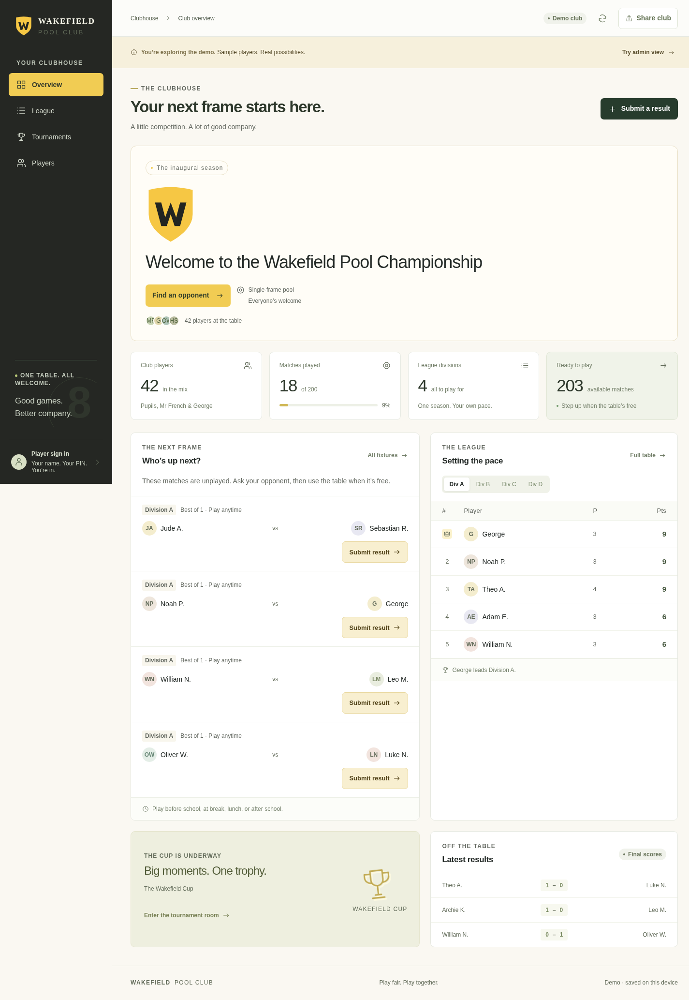

# Wakefield Pool Club

A responsive pool league and tournament app for Mr French, George, and the pupils, hosted on Sites with its built-in D1 database. Warm white, charcoal, and Wakefield gold. Pupils use a shared link and individual PINs, without email addresses or ChatGPT accounts. No runtime package dependencies are required. The older Netlify/Supabase hosting option is retained below.

## Try the downloadable demo

Download this branch using GitHub's **Code → Download ZIP**, extract it, and open **demo/index.html** in a normal web browser. This is a self-contained sample club; it does not require Node, installation, Supabase, or a server. Click **Try admin view** to explore. If your device opens HTML in a file preview that blocks JavaScript, open the file in a browser instead. Shared pupil results use the published Sites app and its built-in database. The standalone demo is separate and never writes to the shared club.

The checked-in demo is a snapshot. After changing the app, run `npm run build` and copy `dist/demo.html` to `demo/index.html` to refresh it.

## Clubhouse interface

The app uses a charcoal sidebar, Wakefield gold accents, and a responsive clubhouse dashboard. On phones, persistent bottom navigation keeps the league, cups, players, and administrator menu within reach.



- The dashboard prioritises available fixtures and recent results. Signed-in pupils see their own opponents and division first.
- **Your next league match** appears on the overview and league pages. Signed-in players see their own plan; the player selector also lets visitors and Mr French look up any player. The suggestion uses current-division fixtures in deterministic saved round order, skipping completed matches and scores awaiting approval. Returned scores regain their place. Every unplayed fixture remains available whenever both players are free; there are no fixed playing times and no saved league migration is needed.
- League standings and fixtures have separate views. Fixtures support player search, available/pending/played filters, an optional "My matches only" switch, and progressive loading.
- Single-frame results require an explicit winner choice; no winner is preselected. Longer matches use frame counts. Signing in from a fixture returns the player to that fixture.
- The player directory includes live search and player profiles. Administrators manage display names, ability ratings, and PINs from the player cards.
- Tournament brackets include a round selector for navigating wide draws on phones. Pending ties show their approval state.
- The approval queue explains approve/return behaviour and exposes both players and the submitted score. Mobile administrators reach approvals and settings through **Manage**.

`scripts/ux-smoke.mjs` checks these interaction paths and all six screens at 320, 390, 768, 1024, and 1440 pixels. Like the other browser scripts, it requires the development server and Chromium's CDP endpoint on port 9222. Mobbin references were retrieved and visually reviewed for this redesign; see the design notes below.

## Mobbin design review

The mobile-first design pass preserved the competition engine, saved data format, server-side PIN handling and result approval permissions. The Sites hosting implementation described below replaces the external Supabase connection with D1. The existing Settings logo is used consistently in the sidebar, mobile header, welcome area, dialogs, footer and browser icon. The crest shown in the chat screenshot has not been embedded because its original image bytes are not available in the workspace; until Mr French uploads that image in Settings, these positions show the existing W placeholder.

References actually retrieved and viewed through Mobbin:

- [WHOOP leaderboard (iOS)](https://mobbin.com/screens/ae62ddea-7e67-4201-9d13-aa0fc67af1aa): ranked rows and compact view filters informed clearer standings typography and larger division controls.
- [Sweatcoin leaderboard (iOS)](https://mobbin.com/screens/7019827a-0f23-4d76-902b-a288db31d3de): separated names and numeric values informed stronger points emphasis and row alignment. This is a structural reference, not a pool competition model.

Our own product decisions: the home shortcut opens available fixtures and enables “My matches only” for signed-in pupils; match actions say “Submit result”; wording distinguishes unplayed fixtures from actual player availability. Text and touch controls are larger, with charcoal and warm-white surfaces and Wakefield gold actions. Existing standings, cup rounds, approval queue, rules, PIN flows, and crest upload remain available. A web-reference search returned unrelated products, which were not used as design evidence.

[Before and after, mobile](docs/mobile-before-after.png) · [Desktop preview](docs/clubhouse-desktop.png) · [Mobile preview](docs/clubhouse-mobile.png)

Pushing this branch updates GitHub only. Sites publication uses its native source repository and deployment tools; a successful local build does not confirm publication. The optional legacy Netlify deployment uses its own branch/build configuration.

## Run locally

Requires Node.js 22 or later (Node 24 also works).

```sh
npm run dev
npm test
npm run build
```

The legacy Netlify development server uses port 5173. Until its live credentials are configured, the app clearly displays a **demo club**, stored only in this browser. Demo has 42 fictional/sample players, four divisions, and a cup. Click **Try admin view** to explore administration. Sample player PIN: `1234`. Demo data is never copied to the live club. Do not put real pupil data into a shared demo browser.

For a preview without a server, run `npm run build` and open **dist/demo.html** in a browser. This self-contained file includes its styles and JavaScript and makes no API requests. It is always a local sample demo, even if live credentials exist. Embedded viewers that block JavaScript cannot run the app; download and open the HTML in a normal browser instead. Use the published Sites app for shared pupil results.

## Optional legacy Netlify/Supabase hosting

1. Create a Supabase project. In its SQL editor, run the complete contents of `supabase.sql`. This creates private state and login-throttling tables. Row-level security is enabled, with no anonymous or authenticated access; only the server-side service role can access club data.
2. Import this GitHub repository into Netlify. Build command: `npm run build`; publish directory: `dist`; functions directory: `netlify/functions`. `netlify.toml` supplies these settings.
3. In Netlify's environment settings, add these **server-side** variables with Functions scope:

   | Variable | Value |
   | --- | --- |
   | `SUPABASE_URL` | Your project URL, e.g. `https://PROJECT.supabase.co` |
   | `SUPABASE_SERVICE_ROLE_KEY` | Your project's legacy service-role API key; never the public anon key |
   | `ADMIN_PASSWORD` | A unique password, at least 12 characters, for Mr French |
   | `SESSION_SECRET` | A randomly generated secret of at least 32 characters |

   Generate a session secret locally with `node -e "console.log(require('crypto').randomBytes(32).toString('hex'))"`. Never put keys or passwords in Git, frontend variables, screenshots, or chat. Keep the service-role key private: it bypasses RLS. Redeploy after setting variables. No browser Supabase client or public key is needed.
4. Visit your Netlify site. The header should say **LIVE CLUB**. If configuration is absent or incomplete it says **DEMO CLUB**. If credentials are present but the database cannot connect, the app reports a connection failure rather than silently replacing live data with demo data.
5. Sign in as **Mr French** using the administrator password. The real club starts with **Mr French** and **George**, with no competitions or sample results.
6. In **Players**, add the pupils (one display name per line). Prefer first names and surname initials. Set optional 0–100 ability ratings to balance groups; all-zero ratings produce a random draw.
7. In **Settings**, upload the supplied Wakefield logo (PNG/JPEG/WebP under 500 KB), confirm school rules, and save. The default W monogram is a placeholder, not a reproduction of the crest.
8. Generate all player PINs in **Players**. Download the private list immediately; plaintext PINs are not stored or retrievable. Share each six-digit PIN only with its owner. You can reset one pupil's PIN from **Manage player**. PIN resets do not end an already signed-in session; sessions expire after eight hours. Rotate `SESSION_SECRET` and redeploy to invalidate every session if required.
9. Generate the league and create a cup. Share the Netlify link with pupils. Visitors can view standings and display names; signed-in players can submit only their own fixtures. Mr French approves or returns results in **Approvals**.

Supabase and Netlify free plans should be sufficient for this small club under normal use, subject to their current limits. Free Supabase projects may pause after inactivity; resume the project if needed. Configure backups according to your retention needs. The link is public: use minimal pupil display names and follow the school's sharing arrangements.

### Legacy local live-mode development

Copy `.env.example` to `.env`, fill in values privately, and run:

```sh
node --env-file=.env scripts/dev.mjs
```

Local files are ignored by Git. The development server implements the same API handler used by Netlify Functions. No live database or hosting account is provisioned automatically.

## Competition behaviour

- Up to 64 players; designed for approximately 42. Four balanced divisions of 10–11 with the default maximum division size of 11. Each pair plays once in their division; 42 players generate 200 league fixtures.
- All unplayed league fixtures are available immediately, with no bookings, fixed ordering, or end date. One table can serve whichever pair is available.
- Single-frame seven-ball pool by default. Best-of-1/3/5/7/9 options, a separate cup-final default, configurable win points, and editable house rules. Existing matches keep their drawn match length. Changing win points recalculates standings for the current and archived leagues using the current setting.
- Standings: points, then frame difference, then wins, then display name alphabetically. No drawn matches. Equal records remain deterministically ordered alphabetically; there is no automatic playoff.
- Once every league fixture is complete, **Next season** archives the league and exchanges one player between each adjacent pair of divisions (top moves up; bottom moves down). Competition membership is fixed after the draw; add the full roster first. Player display names remain editable. Individual fixture editing, removing players after draws, and withdrawing players are not supported in this first version.
- Cups use random knockout draws, automatic byes up to the next power of two, winner progression, and an optional plate for actual first-round losers. The plate is generated when every opening tie is complete. Players receiving a bye do not enter the plate. Multiple tournaments can run alongside the league; tournaments have no scheduling deadline in this version.
- Pending scores never count until approved (default). Returned scores are removed from the queue and can be submitted again. Approved scores cannot be overwritten in the interface; resolve an incorrect approved score through an administrator database correction/backup restoration for now.
- Settings, names, competitions, and approved scores are shared through the server. Refresh to receive changes from another device; live polling is not enabled.

## Security and persistence

Netlify Functions validate roles, participants, scores, and revisions server-side. PINs are salted and scrypt-hashed. Administrator login uses a server environment password. Login attempts are limited to eight per public IP per 15 minutes in the database (a shared school network shares this limit). Sessions use signed HttpOnly, SameSite cookies, Secure on hosted HTTPS, and expire after eight hours. Origin validation protects mutation requests. Tables have RLS enabled and no browser policies. Private PIN hashes never leave the server.

The app uses one private JSON state row with optimistic revision checks. Conflicting submissions are rejected and refreshed; they are not overwritten. This is appropriate for a small school club, not a large multi-school service. Supabase must remain reachable by Netlify Functions. Read the SQL and server handler before changing database permissions.

## Verification

`npm test` exercises league pairing, standings, score validity, approval and role enforcement, best-of-five results, all knockout draw sizes from 2 through 64, consolation progression, and promotion/history. `npm run build` creates deployable static files. Browser smoke checks can be run with `node scripts/browser-smoke.mjs` while the dev server and a Chromium CDP endpoint on port 9222 are running. Supabase connectivity and deployed Netlify Functions require your own project configuration and must be checked after deployment.


## Sites hosting

[Wakefield Pool Championship on Sites](https://wakefield-pool-championship.stevefrench81.chatgpt.site/) runs the app and its shared D1 database. Netlify and Supabase are not required for this version. The site is configured for anyone with the shared link; pupils sign in with their individual club PIN and do not need email addresses or ChatGPT accounts.

Mr French signs in through **Mr French → Sign in with ChatGPT**, using the linked owner account. The backend binds that verified account to one administrator identity. Other ChatGPT accounts do not receive administrator access. Mr French adds display names, generates private player PINs, draws competitions, and approves or returns submitted results.

The live club starts with Mr French and George, without sample results. The checked-in `demo/index.html` remains a self-contained sample club stored only in the visitor's browser. An unavailable live database produces an explicit error rather than silently loading demo data.

`npm run test:sites` builds and tests the Sites Worker, including real SQLite-backed checks for owner identity, PIN privacy, sessions, shared state, optimistic revision conflicts, result approvals and login throttling. `npm run build:sites` produces the Worker with embedded frontend assets in `dist/server/index.js`. The default `npm run build` still creates the optional Netlify build and standalone demo. Run `npm run db:generate` after changing `db/schema.ts`; commit the generated SQL and Drizzle metadata. Sites applies hosted migrations during publication.

The tracked `.openai/hosting.json` identifies the existing Sites project and its `DB` binding. Sites provisions the database. `ADMIN_EMAIL` and `SESSION_SECRET` are server-side Sites secrets, never frontend values or repository files. The configured owner's verified email bootstraps the durable per-Site administrator ID. Source deployed to Sites is held in its native source repository; these files mirror that implementation for GitHub review.

The Worker keeps salted scrypt PIN hashes private, signs HttpOnly/SameSite player sessions, checks roles and participants server-side, bounds request bodies, and rejects stale revisions rather than overwriting another result. Club data lives in D1 across devices. Login attempts are limited to eight per network address in 15 minutes; visitors may share that limit when the school or hosting gateway shares an address.

The optional legacy Netlify/Supabase instructions above remain available for a separate deployment. The old Netlify site is not disabled or deleted by a Sites publication.
